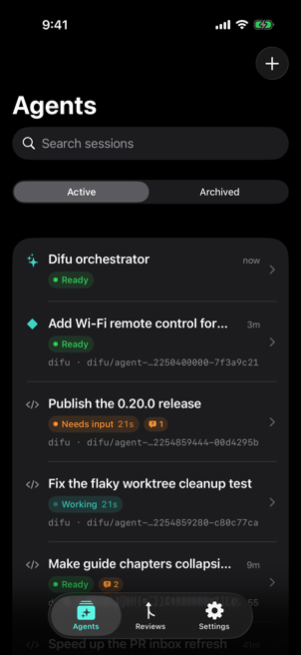
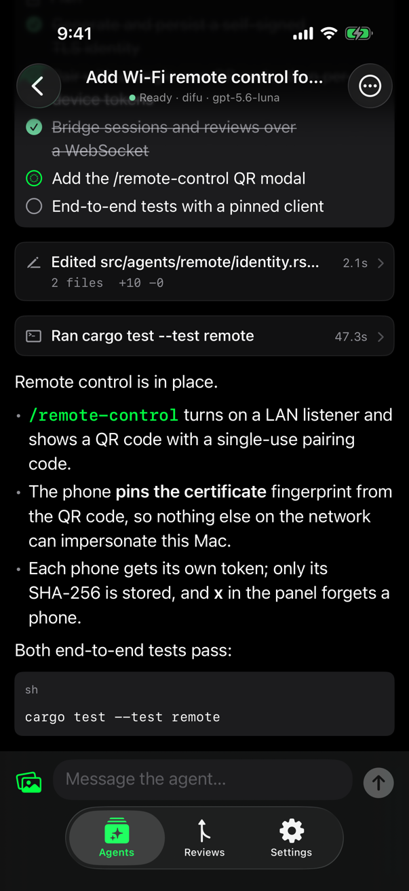
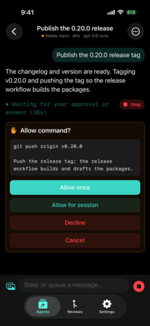
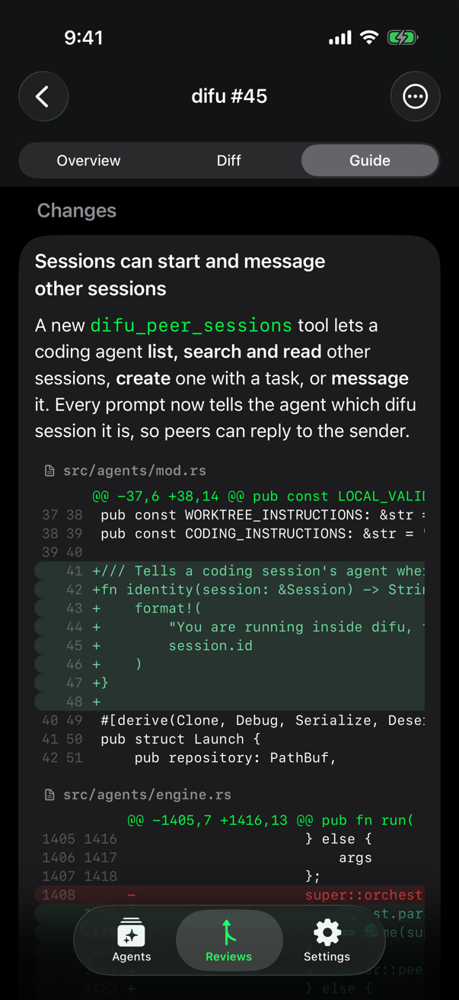

# difu for iOS

A native iPhone companion for [difu](../../README.md). Pair it with difu on
your Mac (over your Wi-Fi) and with difu cloud servers (from anywhere), and
control everything: watch and steer coding agents, answer their questions and
approvals, start new sessions, and review GitHub pull requests (overview with
its images, diff, guide, comment, approve, merge).

The phone talks to each difu's background agent service using the protocol in
[`docs/remote-protocol.md`](../../docs/remote-protocol.md) and its cloud
additions in [`docs/cloud-agents.md`](../../docs/cloud-agents.md): a WebSocket
over TLS, pinned to the certificate fingerprint from the pairing QR code (or
the one proven by the server password).

<p>
  
  
  
  
</p>

More in [`screenshots/`](screenshots/), taken in the iOS Simulator against a
demo difu.

## Run it on your iPhone

Requirements: Xcode 26 or later with the iOS platform installed
(**Xcode › Settings › Components**), and an iPhone running iOS 17 or later.

1. Open `app/ios/Difu.xcodeproj` in Xcode.
2. Select the **Difu** target › **Signing & Capabilities** and choose your
   team. If Xcode says the bundle identifier `app.difu.ios` is unavailable,
   change it to something unique, such as `com.yourname.difu`.
3. Connect your iPhone, select it as the run destination, and press **Run**.
   The first time, you might need to trust the developer certificate on the
   phone (**Settings › General › VPN & Device Management**) and turn on
   Developer Mode.

## Pair with your Mac

1. On the Mac, open difu, press **⌘K**, and run **`/remote-control`**.
2. On the phone, tap **Scan QR Code** and point the camera at the code.
   You can also press **c** in `/remote-control` to copy the pairing link,
   then tap **Paste Pairing Link** on the phone (Universal Clipboard carries
   it across), or open the `difu://pair?…` link on the phone.
3. When iOS asks to find devices on your local network, tap **Allow**.

Pairing codes are single-use and expire after 10 minutes.

## Add a cloud server

A server set up with `difu server add` (see
[`docs/cloud-agents.md`](../../docs/cloud-agents.md)) can be added in two ways:

- **Address and password**: tap **Use Address and Password** and enter the
  server's IP address or DNS name (port 3438 unless you add `:port`) and its
  server password. The password proves the server is genuine before the phone
  trusts its certificate, so nobody in between can impersonate it.
- **QR code**: run `difu server pair <name>` on your Mac (or `difu remote pair`
  on the server) and scan the code.

Add more computers and servers from **Settings › Servers › Add Server**. The
app connects to all of them while it's open and shows their sessions in one
list (with a server badge once there's more than one). New sessions start by
picking a server. Each server's page in Settings shows its disk space (free
space, status, what uses it, and cleanups for archived worktrees, build outputs
and sandbox storage), logins (GitHub and Codex device-code login, Claude Code
token), repositories (add, remove, **Refresh Mains**), new session defaults,
repository rules and paired devices.

**New Session** starts from the chosen computer's or server's new session
defaults: its default repository, model and effort. When it saved no model, the
sheet picks Claude Opus (the newest Opus that computer's Claude Code offers)
with extra-high reasoning, or the highest it supports; without Claude Code
there, it stays on Default. Repositories, models and defaults load
independently, every control works while they do, and what you choose stays
when lists arrive. Type another repository (`owner/name` on a server, a full
path on a computer) to use one that isn't listed.

**Settings › (server) › New Session Defaults** changes those defaults on that
computer or server, where its terminal and agents use them too: provider and
model, effort, starting mode and repository (each session gets its own
worktree). **Use Claude Opus · xhigh** saves that in one tap. Computers with an
older difu don't show the screen and still get the Opus preselection.

In a session, type **/** at the start of the message to see its commands:
difu's (compact, model and effort, status and usage, permissions, rules,
changes, rename, new session, clear, change repository) and the agent's own
skills and commands, each from the computer or server running the session.
Choosing one runs it (asking first for destructive ones), opens its screen, or
puts it in the message to add arguments. **Model & Effort** lists every
provider's models; picking another provider's switches the session there once
it's between turns.

When an agent asks a question, tap **Add a note** to send a note with the
option, options or "Other" answer you choose, as the terminal does. Permission
prompts, tool forms and secret answers take no note.

Images in a pull request's description and comments load through the computer
or server showing the PR, which uses its own GitHub login, so private
attachments work. Tap one to view it full screen and pinch to zoom; images that
can't be shown offer **Open in browser**.

**Forget** revokes the phone on that server first, then removes it from the
phone. When another device pairs with one of your servers, a banner offers to
revoke it.

## App lock

difu asks for Face ID (or your passcode) when it opens and after 5 minutes in
the background. Turn it off in **Settings › Security**.

## Troubleshooting

- **"Can't reach …"**: for a Mac, the phone and Mac must be on the same
  network. Guest networks and some office networks isolate devices from each
  other; a VPN on either device can also get in the way. For a cloud server,
  check that it's running (`difu server list` on your Mac) and that its
  firewall allows difu's port (3438 by default).
- **Local Network permission**: if you tapped **Don't Allow**, turn it on in
  iOS **Settings › Privacy & Security › Local Network › difu**.
- **macOS firewall**: when the Mac asks whether `difu` may accept incoming
  network connections, choose **Allow**. If you denied it, change it in
  **System Settings › Network › Firewall › Options**.
- **Remote control off**: difu only listens after `/remote-control` was
  enabled, and keeps listening until you disable it there.
- **"This phone is no longer paired"**: the Mac or server forgot this phone.
  Pair again.
- **Certificate mismatch**: the remote-control certificate changed, for
  example because difu's `agents/remote/` folder was deleted. Pair again.
- **Wrong server password**: repeated failures are rate-limited for a while.
  Change the password with `difu remote password` on the server.

## Project layout

| Path | What it is |
| --- | --- |
| `Difu/` | The SwiftUI app (a synchronized folder: new files are picked up automatically). |
| `Config/Info.plist` | Camera, Face ID, Local Network and ATS keys, and the `difu://` URL scheme. Merged with the keys Xcode generates. ATS is relaxed (`NSAllowsArbitraryLoads`) because difu servers use self-signed certificates on arbitrary hosts, which the app pins itself; the app makes no other web requests. For App Store or TestFlight review, the justification is: "connects only to user-owned servers at user-entered addresses, using self-signed certificates pinned by SHA-256 fingerprint." |
| `DifuKit/` | Swift package with everything that doesn't need UIKit: protocol models, pairing links, addresses and password pairing, the saved-server Keychain store, the pinned WebSocket client, transcript delta application, Markdown and diff helpers. Builds and tests on macOS. |
| `DifuKit/Sources/difu-remote-probe/` | A command-line client for testing a real difu from the Mac. |

## Development

Test the shared logic on the Mac:

```sh
cd app/ios/DifuKit
swift build
swift test
```

Build the app from the command line (the iOS platform must be installed):

```sh
xcodebuild -project app/ios/Difu.xcodeproj -scheme Difu \
  -destination 'generic/platform=iOS' CODE_SIGNING_ALLOWED=NO build
```

### Probing a real difu

`difu-remote-probe` pairs like a phone and exercises the protocol, printing
clear errors (TLS certificate mismatch, denied, per-host timeouts). It stores
its token in `~/.difu-remote-probe.json` (override with `--store <path>` or
`DIFU_PROBE_STORE`).

```sh
cd app/ios/DifuKit
swift run difu-remote-probe pair 'difu://pair?v=1&n=…'   # quote the link
swift run difu-remote-probe join 203.0.113.5            # server password (prompt or DIFU_PROBE_PASSWORD)
swift run difu-remote-probe info
swift run difu-remote-probe sessions
swift run difu-remote-probe watch <session-id> 15       # events for 15 s
swift run difu-remote-probe send <session-id> "Run the tests" --queue
swift run difu-remote-probe inbox --refresh
swift run difu-remote-probe overview opencx-labs/difu 45
swift run difu-remote-probe call agents.models          # any method, raw JSON
swift run difu-remote-probe call agents.defaults.set '{"model":"claude/opus","effort":"xhigh"}'
swift run difu-remote-probe call session.commands '{"id":"…"}'
swift run difu-remote-probe call session.command '{"id":"…","name":"/compact"}'
swift run difu-remote-probe call session.entry '{"id":"…","entry":"item_12"}'
swift run difu-remote-probe forget --revoke             # device.unpair, then delete the token
```
